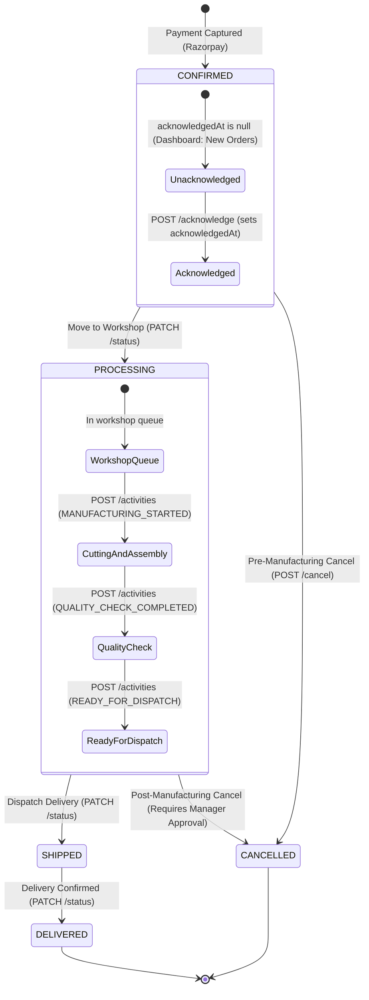

# Order Lifecycle and Shop-Floor Operations

Timmbr operates on a made-to-order furniture model. Products are manufactured or customized specifically after a customer places and pays for an order. Because production spans multiple days across workshop stations, `timmbr-core` and `timmbr-companion` separate the macro commercial status from granular workshop milestones.

## Dual-Track Architecture

The system tracks orders along two independent paths:

1. **Macro Order Status (`Order.status`)**:
   Tracks the commercial and fulfillment stage across storefront, staff app, and billing services. It uses the `OrderStatus` enum (`CONFIRMED`, `PROCESSING`, `SHIPPED`, `DELIVERED`, `CANCELLED`).

2. **Operational Ledger (`OrderActivity`)**:
   Records every internal shop-floor milestone, customer message, acknowledgement, and delivery event in a chronological ledger. Activities maintain an explicit visibility flag (`isCustomerVisible`).

## Dashboard Queues

The Dashboard provides four clickable statistic cards. All four queues filter strictly for orders with verified payment (`payments.status = 'PAID'`). Unpaid orders never appear in the companion app.

| Dashboard Card | Filter Conditions | Operational Purpose |
| --- | --- | --- |
| **New Orders** | `status = 'CONFIRMED'` AND `acknowledgedAt IS NULL` | Paid orders waiting for staff review and workshop acceptance. |
| **Processing** | `status = 'PROCESSING'` | Orders currently in production, assembly, or quality inspection. |
| **Out for Delivery** | `status = 'SHIPPED'` | Orders loaded on vehicles and in transit to the customer. |
| **Completed** | `status = 'DELIVERED'` | Successfully handed over furniture items. |

Tapping any card filters the Orders list by the corresponding criteria.

## Operational Milestones

### 1. Order Acknowledgement
When a staff member reviews a new order, they tap **Acknowledge**:
- Calls `POST /api/v1/admin/orders/:orderId/acknowledge`.
- Sets `Order.acknowledgedAt = now()` and `Order.acknowledgedById = staffUserId`.
- Inserts an internal `OrderActivity` (`eventType: 'ORDER_ACKNOWLEDGED'`, `isCustomerVisible: false`).
- If staff skips this button and moves the order directly to `PROCESSING`, the backend auto-acknowledges the order in the same transaction.

### 2. Moving to Workshop
When material sourcing starts:
- Calls `PATCH /api/v1/admin/orders/:orderId/status` with `{ "status": "PROCESSING", "notes": "..." }`.
- Inserts a customer-visible `OrderActivity` (`eventType: 'STATUS_TRANSITION'`).

### 3. Recording Shop-Floor Milestones
While in `PROCESSING`, staff log granular milestones without changing `Order.status`:
- Calls `POST /api/v1/admin/orders/:orderId/activities`.
- Allowed event types:
  - `MATERIAL_PREPARATION`: Timber and fabric sourcing in progress.
  - `MANUFACTURING_STARTED`: Core cutting and joinery begins. **Locks direct staff cancellation**.
  - `MANUFACTURING_UPDATE`: General workshop progress update.
  - `QUALITY_CHECK_COMPLETED`: Quality inspector signs off on build quality.
  - `READY_FOR_DISPATCH`: Items packaged and labeled for vehicle loading.
  - `DELIVERY_COORDINATION`: Internal scheduling notes.

### 4. Customer Progress Updates
Staff with `orders:message` permission can update the customer directly:
- Calls `POST /api/v1/admin/orders/:orderId/customer-updates`.
- Update categories: `PREDEFINED_UPDATE`, `CUSTOM_MESSAGE`, `MANUFACTURING_UPDATE`, `DELAY_NOTIFICATION`, `DELIVERY_COORDINATION`.
- Staff select between **Update only** (updates customer tracking page) or **Update and notify** (also queues an asynchronous email via BullMQ).

## Two-Tier Cancellation Policy

Because custom furniture entails non-recoverable timber and craftsmanship costs once manufacturing begins, cancellation enforces strict server-side gates:

### Tier 1. Pre-Manufacturing Cancellation
- Valid when `status = 'CONFIRMED'` or `status = 'PROCESSING'` before `MANUFACTURING_STARTED` has been logged.
- Authorized staff with `orders:cancel` permission submit a cancellation reason.
- Order transitions immediately to `CANCELLED`.

### Tier 2. Post-Manufacturing Cancellation
- Applies once `MANUFACTURING_STARTED` is recorded on the order ledger (`hasManufacturingStarted = true`).
- Standard staff cancellation is locked.
- Exceptional cancellation requires manager review and approval:
  1. Staff submits `POST /api/v1/admin/orders/:orderId/cancel` which flags the order for review.
  2. A user with `ADMIN` or `MASTER` role evaluates the request and calls `POST /api/v1/admin/orders/:orderId/cancel/approve`.
  3. The order transitions to `CANCELLED`.
- Financial refunds are managed separately from order cancellation.
