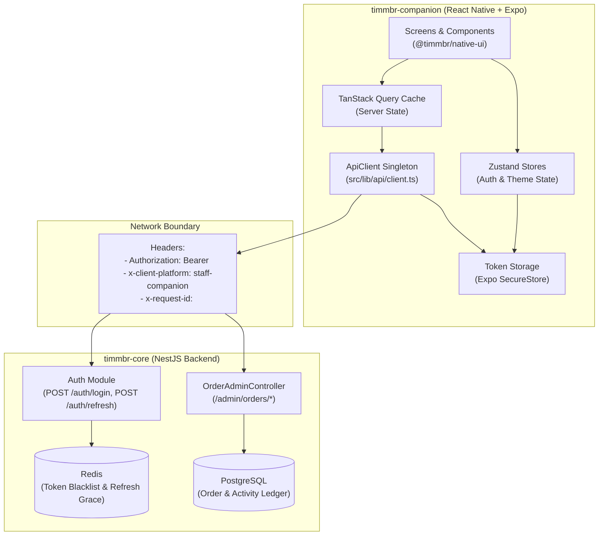

# System Design Architecture

This document describes the runtime architecture of `timmbr-companion`.

## System Overview

`timmbr-companion` is a specialized mobile client for workshop craftsmen, supervisors, and delivery drivers. The app connects to the `timmbr-core` NestJS backend. It consumes REST endpoints under `/api/v1/` and renders UI using `@timmbr/native-ui` primitives.

## Client Layer Separation

The codebase divides responsibility into three discrete layers:

### 1. Presentation Layer (`app/` and feature components)
Screens are organized into file-based routes using Expo Router:
- `app/(auth)/`: Unauthenticated entry point containing staff login.
- `app/(tabs)/`: Main navigation shell containing Dashboard, Orders, and Profile tabs.
- `app/orders/`: Deep-linkable order details and activity timeline screens.

Every screen uses components from `@timmbr/native-ui`. Static copy lives in co-located `strings.ts` files. Components never make direct network calls.

### 2. State & Cache Layer (`src/features/*/hooks` and `store/`)
State divides into two categories:
- **Server State**: Managed by TanStack Query. Query keys follow hierarchical arrays (`['orders', 'list', filters]`, `['orders', 'detail', orderId]`). Mutations update local caches or invalidate stale queries on completion.
- **Client State**: Managed by lightweight Zustand stores. `auth.store.ts` tracks active session credentials and permission sets. `theme.store.ts` tracks color mode preferences (`light`, `dark`, `system`).

### 3. Transport & Storage Layer (`src/lib/api/`)
The `ApiClient` singleton wraps `fetch` to enforce uniform request handling:
- Automatically injects `x-client-platform: staff-companion`.
- Attaches the current Bearer access token from `tokenStorage`.
- Generates a unique `x-request-id` header for request correlation.
- Maps error responses into structured `ApiError` instances.
- Manages single-flight access token rotation when the server returns HTTP 401.

## Authentication and Security Boundary

### Staff Access Control
Only users with staff access can authenticate. The backend rejects customer accounts (`USER` role). The app validates that the user holds one of the authorized roles upon login:
- `MASTER`: Unrestricted administrative access.
- `ADMIN`: Organization administrative access.
- `STAFF`: Granular permission-based access.

For `STAFF` users, the app checks granular permissions (`orders:read`, `orders:update`, `orders:message`, `orders:cancel`, `orders:deliver`) before rendering actions. The backend enforces these checks authoritatively on every route.

### Token Lifecycle & Storage
1. On successful login (`POST /api/v1/auth/login`), the server returns `{ accessToken, refreshToken, user }`.
2. `tokenStorage` saves both tokens using `expo-secure-store` on native devices, with encrypted in-memory fallback on web development environments.
3. Access tokens carry a short lifespan (15 minutes). Refresh tokens are long-lived and single-use.
4. When an access token expires, `ApiClient` queues concurrent requests, requests new tokens via `POST /api/v1/auth/refresh`, updates storage, and retries the queued requests.
5. `timmbr-core` enforces a 10-second grace window on rotated refresh tokens to prevent race conditions during parallel requests.

## Network Resilience and Idempotency

Workshop environments often have intermittent Wi-Fi connectivity. The client guards against duplicate submissions and timeouts:

1. **Deterministic Idempotency Keys**:
   Every state change mutation (`POST /activities`, `POST /customer-updates`, `POST /cancel`) generates a UUIDv4 idempotency key before sending the payload. The backend detects duplicate keys and returns the existing entity without executing side effects twice.

2. **UI Action Locks**:
   Action buttons disable immediately upon tap and display a loading spinner while the mutation is in flight.

3. **Configurable Request Timeouts**:
   The HTTP client uses `AbortController` with a configurable timeout (`EXPO_PUBLIC_REQUEST_TIMEOUT_MS`, default 15000ms). Requests that exceed this window abort cleanly and raise a typed `ApiError`.
