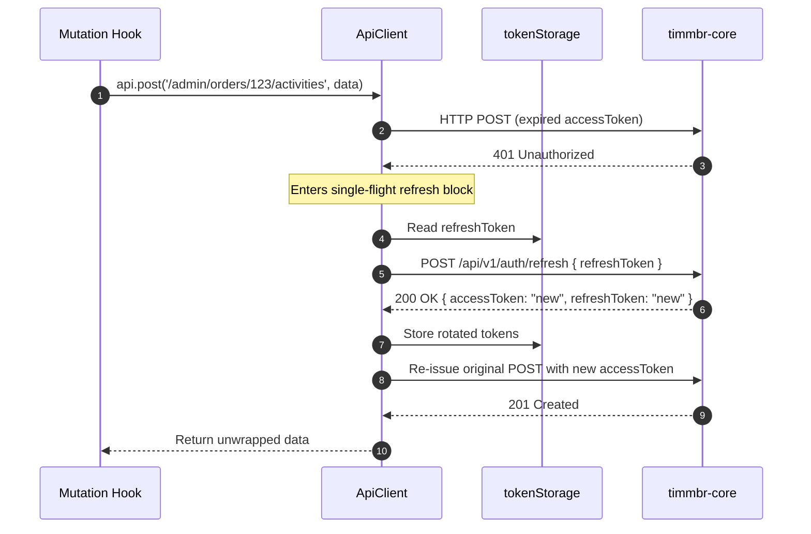

# API Client Conventions

All backend communication in `timmbr-companion` flows through the centralized `ApiClient` instance. Components and hooks must not call `fetch` directly.

## Client Responsibility

The `ApiClient` class in `src/lib/api/client.ts` enforces four rules across every network request:
1. Injects `x-client-platform: staff-companion`.
2. Attaches the current access token as a Bearer credential.
3. Attaches an `x-request-id` UUID for distributed tracing.
4. Unwraps `ApiResponse<T>` envelopes and normalizes backend error responses into typed `ApiError` exceptions.

## Envelope and Error Contracts

### Success Envelope (`ApiResponse<T>`)
`timmbr-core` wraps successful JSON payloads in an envelope:

```typescript
export interface ApiResponse<T> {
  success: boolean;
  data: T;
  meta?: {
    page?: number;
    limit?: number;
    total?: number;
    totalPages?: number;
    hasNextPage?: boolean;
    hasPrevPage?: boolean;
  };
}
```

The `ApiClient` methods (`get`, `post`, `patch`, `put`, `delete`) automatically unwrap `.data` and return it to the caller.

### Error Envelope (`ApiError`)
The backend `GlobalExceptionFilter` returns structured error payloads:

```typescript
export interface ApiErrorPayload {
  statusCode: number;
  message: string | string[];
  error: string;
  timestamp: string;
  path: string;
  correlationId?: string;
}
```

When HTTP status is not in the 200–299 range, `ApiClient` parses this payload and throws an `ApiError` instance:

```typescript
export class ApiError extends Error {
  readonly statusCode: number;
  readonly error: string;
  readonly timestamp: string;
  readonly path: string;
  readonly correlationId?: string;
  readonly validationErrors: string[];

  constructor(payload: ApiErrorPayload) {
    const message = Array.isArray(payload.message)
      ? payload.message.join(', ')
      : payload.message;
    super(message);
    this.name = 'ApiError';
    this.statusCode = payload.statusCode;
    this.error = payload.error;
    this.timestamp = payload.timestamp;
    this.path = payload.path;
    this.correlationId = payload.correlationId;
    this.validationErrors = Array.isArray(payload.message) ? payload.message : [];
  }
}
```

## Token Refresh and Request Queueing

When the backend returns HTTP 401, `ApiClient` executes a single-flight token rotation:



Parallel requests that fail with 401 while a refresh is in progress subscribe to the same pending promise. Once the refresh completes, all queued requests replay using the new access token.

## Usage Example

### Query Hook Example

```typescript
import { useQuery } from '@tanstack/react-query';
import { apiClient } from '@/lib/api/client';
import type { DashboardStats } from '../types/order.types';

export function useDashboardStats() {
  return useQuery({
    queryKey: ['orders', 'dashboard-stats'],
    queryFn: () => apiClient.get<DashboardStats>('/admin/orders/dashboard-stats'),
    staleTime: 30000,
  });
}
```

### Mutation Hook with Idempotency Key

```typescript
import { useMutation, useQueryClient } from '@tanstack/react-query';
import { apiClient } from '@/lib/api/client';
import type { CreateOrderActivityDto, OrderActivity } from '../types/order.types';

export function useRecordActivity(orderId: string) {
  const queryClient = useQueryClient();

  return useMutation({
    mutationFn: (dto: CreateOrderActivityDto) =>
      apiClient.post<OrderActivity>(`/admin/orders/${orderId}/activities`, {
        ...dto,
        idempotencyKey: crypto.randomUUID(),
      }),
    onSuccess: () => {
      queryClient.invalidateQueries({ queryKey: ['orders', 'detail', orderId] });
      queryClient.invalidateQueries({ queryKey: ['orders', 'activities', orderId] });
    },
  });
}
```
